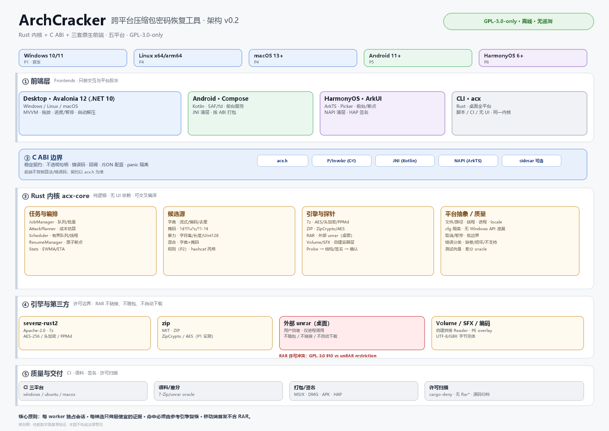

# ArchCracker

跨平台压缩包密码恢复工具：**Rust 内核 + 原生前端**，目标覆盖 Windows、Linux、macOS、Android、HarmonyOS。

> **状态：W1 进行中（Windows 全栈优先）**。ZIP + 字典 + 多线程 CLI 垂直切片已跑通；下一步补齐 deflate/AES/7z/RAR 与基准，再做 GUI。Linux/macOS/Android/HarmonyOS 的接口保留但**后续排期**。
>
> **合法使用**：仅用于恢复你本人拥有或已获明确授权的归档密码。不得用于未授权访问、撞库或规避他人安全措施。

## 目标

- **格式**：7z（AES-256、可选头加密）、ZIP（ZipCrypto、WinZip AES-128/256；AES 支持待 P1 实测）、RAR4/RAR5（Windows 首发：调用已安装的 WinRAR/`UnRAR.exe`；解压 RAR 本身符合 unRAR 许可，许可边界见 `docs/licensing.md`），以及分卷、SFX。
- **攻击方式**：字典、掩码、暴力（数字/大小写字母/符号/自定义字符集 + 长度区间）、字典+掩码混合；规则引擎为 P2。
- **性能**：每 worker 复用归档会话、只测最小加密条目、首块快速判错、命中后内置引擎完整解压复核；多核/多进程并行、断点续跑。
- **形态**：同一 Rust 内核 + C ABI；Windows 用 Avalonia 12；CLI 可独立运行。Android/HarmonyOS 前端后续再做。
- **隐私**：默认零网络、无遥测、无强制更新。

## 架构



```text
┌──────────────────────────────────────────────────────────────────┐
│ Frontends                                                        │
│  Avalonia 12 (Win/Linux/macOS) · Compose (Android) · ArkUI (OHOS)│
│  CLI (all desktop platforms)                                     │
└───────────────────────────────┬──────────────────────────────────┘
                                │ C ABI / JNI / NAPI
┌───────────────────────────────▼──────────────────────────────────┐
│ acx-core (Rust)                                                  │
│  jobs · planner · scheduler · resume · stats                     │
│  candidates: dictionary / mask / brute / rules / hybrid          │
│  engines: 7z · ZIP · RAR · volumes · SFX · fast probes           │
│  platform: file access / process / threads (no UI deps)          │
└───────────────────────────────┬──────────────────────────────────┘
                                │
        sevenz-rust2 · zip · 外部 unrar（Windows，仅进程调用） · rayon · aes/sha2
```

- **内核**：Rust workspace，纯逻辑、可交叉编译；不依赖任何 UI 框架。
- **前端**：Windows 用 Avalonia 12，通过 P/Invoke 调 C ABI；崩溃隔离可选用 sidecar 进程。Android JNI / HarmonyOS NAPI 的接口保留，后续实现。
- **引擎边界**：7z/ZIP 使用宽松许可的 Rust 库；RAR 的**解压用途**由 unRAR 许可允许，当前只处理 Apache-2.0 下的组件边界：Windows 调用用户已安装的 WinRAR/`UnRAR.exe`，不把 unRAR 链进主项目（详见 `docs/licensing.md`）。

## 当前优先级：Windows 全栈

本迭代按“能装、能用、能卸载”的 Windows 产品推进：

1. Rust 内核 + CLI：ZIP/7z/RAR（外部）+ 字典/掩码/暴力 + 多线程 + 断点。
2. Avalonia 12 桌面：拖放、模式、进度、暂停/停止、结果、自动解压。
3. Windows 交付：MSIX/Inno 安装包、代码签名、崩溃转储、zh/en。
4. 测试/基准：1M 字典、1GB 归档、缺卷/损坏/未加密分类。

Linux/macOS/Android/HarmonyOS 的架构与契约在此阶段保留，但**不排期、不引入 SDK**；Windows 发布后再逐平台移植。

## 平台矩阵

| 平台 | 前端 | 内核交付 | 阶段 | 备注 |
|---|---|---|---|---|
| **Windows 10/11 x64** | Avalonia 12（.NET 10） | `acx.dll` + CLI | **当前（W1–W5）** | 唯一排期平台；全栈交付 |
| Linux x64/arm64 | Avalonia 12 | `libacx.so` + CLI | 后续 | Windows 发布后 |
| macOS 13+ arm64/x64 | Avalonia 12 | `libacx.dylib` + CLI | 后续 | 公证；不上 Mac App Store |
| Android 11+ | Kotlin + Compose | `libacx.so`（JNI） | 后续 | SAF、前台服务 |
| HarmonyOS 6+ | ArkTS/ArkUI | `libacx.so`（NAPI） | 后续 | DevEco 签名 |

> 版本号（.NET 10、Avalonia 12）以实际 SDK 为准。RAR 在 Windows 通过已安装的 WinRAR/UnRAR 工作；其他平台后续同样走外部 `unrar`，移动端暂不排期。

## 仓库结构

```text
.
├─ core/                 # Rust workspace（M0 起）
│  ├─ crates/acx-core/   # 领域、调度、候选、引擎、探针
│  ├─ crates/acx-cli/    # 跨平台 CLI
│  ├─ crates/acx-ffi/    # C ABI（cdylib/staticlib）+ acx.h
│  ├─ crates/acx-jni/    # Android JNI 薄层
│  └─ crates/acx-napi/   # HarmonyOS NAPI 薄层
├─ frontends/
│  ├─ desktop/           # Avalonia 12
│  ├─ android/           # Kotlin + Compose
│  └─ harmony/           # ArkTS/ArkUI
├─ docs/
│  ├─ architecture.md    # 跨平台总体架构
│  ├─ roadmap.md         # 分阶段开发计划
│  ├─ licensing.md       # Apache-2.0 与第三方许可
│  ├─ adr/               # 架构决策记录
│  ├─ agents/            # 子智能体角色与协作规范
│  └─ analysis/          # 旧工具分析与历史规划（内部研究）
├─ workflows/            # DSH workflow 编排脚本
├─ scripts/              # 环境/语料/构建脚本
├─ tests/                # 跨语言测试向量与语料索引
├─ AGENTS.md             # 所有 Agent 的入口指令
├─ LICENSE               # Apache-2.0
└─ README.md
```

## 快速开始（开发环境）

> 当前 Windows 开发机没有 C++/Rust/.NET SDK；`scripts/bootstrap-windows.ps1` 会以**用户级、免管理员**方式准备工具链。

```powershell
# 1) 检查环境（只读）
powershell -ExecutionPolicy Bypass -File .\scripts\check-env.ps1

# 2) 安装/修复用户级工具链（Rust GNU、MinGW、CMake、Ninja、.NET SDK、GitHub CLI）
powershell -ExecutionPolicy Bypass -File .\scripts\bootstrap-windows.ps1

# 3) M0 之后：
cargo test --workspace
cargo run -p acx-cli -- --help
```

Android/HarmonyOS 工具链（Android SDK/NDK、DevEco Studio）在后续平台启动前单独安装；当前 Windows 阶段不下载数 GB 的 IDE，脚本只给出检查项。

## 文档

- [Windows 全栈开发计划](docs/windows-plan.md)
- [总体架构](docs/architecture.md)
- [跨平台开发策略](docs/cross-platform.md)
- [开发路线图](docs/roadmap.md)
- [许可与合规](docs/licensing.md)
- [架构决策记录](docs/adr/)
- [Agent 协作规范](docs/agents/README.md)
- [旧工具分析（内部研究）](docs/analysis/legacy-tools.md)

## 许可

本项目以 **Apache-2.0** 发布，见 [LICENSE](LICENSE) 与 [NOTICE](NOTICE)。

第三方组件与特殊说明见 [docs/licensing.md](docs/licensing.md)。其中 RAR 支持涉及 unRAR 许可：解压 RAR 本身是许可允许的用途；本项目不链接（静态/动态）、不随包、不自动下载 unRAR 代码或二进制，Windows 首发调用用户已安装的 WinRAR/UnRAR。

## 参与

- 提交前阅读 [AGENTS.md](AGENTS.md) 与 [CONTRIBUTING.md](CONTRIBUTING.md)。
- 任何改动走分支 + PR；核心/前端/测试由不同 Agent 角色分工，详见 `docs/agents/`。
- 禁止提交样本压缩包、破解工具二进制、口令字典或任何未脱敏的用户数据。
