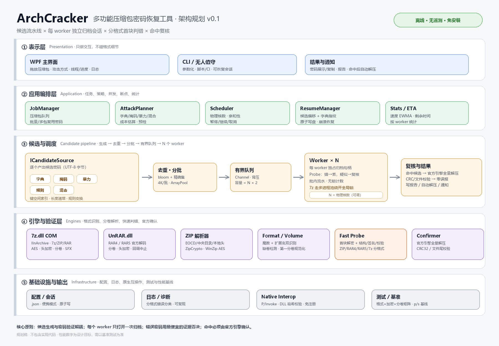

# 从三款旧工具到 ArchCracker：压缩包密码恢复工具分析与架构规划

> 版本：v0.1（规划稿） · 日期：2026-11-24 · 范围：只做分析与框架规划，不含实现代码
>
> 分析对象：工作区中的 `解密1/`、`解密2/`、`解密3/`



---

## 0. 摘要（TL;DR）

三款工具分别代表三个时代：

| 代际 | 代表 | 技术路线 | 核心问题 |
|---|---|---|---|
| 批处理封装（2018–2021） | 解密1、解密2 的 `.bat` 版 | 外部 `7z.exe` + 文本输出解析 | 每个密码启动一个进程，串行，速度停在 10¹ 个/秒量级 |
| 运行时封装（2022） | 解密2 的 C# 1.5.8 | .NET 6 + SevenZipSharp + `7z.dll`，`Parallel.ForEach` | 每个候选重新打开归档并全量 `Check()`；无快筛、无断点、无爆破 |
| 商业爆破器（2004/2008） | 解密3 | Delphi + 自带 RAR 解密 DLL | 单线程、只支持 RAR 1.x–3.x，ZIP 还要另开一个工具 |

**共同瓶颈不是“不会解密”，而是把“验证一个密码”实现成了“重新打开归档 + 完整解压一遍”。** 只要把这件事改成：

1. 每个 worker 只打开一次归档；
2. 每个候选只解密首块，用结构/校验/签名做“否错”；
3. 只有疑似命中才用官方引擎完整解压确认；
4. 候选生成与密码验证彻底解耦，用有界队列喂给 N 个 worker；

速度就能从 10¹/秒 提升到 10³–10⁵/秒（按格式不同），并且仍然保持零误报。

**推荐技术路线**：C# / .NET 8 + WPF + 自写 `7z.dll` COM 封装 + 官方 `unrar.dll`；先做“正确但还不快”的 MVP，再加 ZIP/RAR/7z 的分格式快速判错；7z 的全局锁用多进程 worker 池或自实现 KDF 绕过。

---

## 1. 分析对象与方法

### 1.1 样本清单

| 目录 | 关键文件 | 大小 | 版本 / 来源 | 形态 |
|---|---|---|---|---|
| `解密1` | `ErsVId_unrar2.48.exe` | 973,312 B | 2.0.4.8，产品名“解TMD压”，2022-12 | VB.NET WinForms，x86，未签名 |
| `解密1` | `config/setting.ini`、`config/PW.txt` | 112 B / 998,788 B | 用户配置 + 密码库 | 文本 |
| `解密2` | `压缩包密码测试工具.bat` | 819,948 B | 2021，Batch + 内嵌 7-Zip 19.00 | 批处理单文件 |
| `解密2` | `ArchivePasswordTestTool.exe` | 67,694,760 B | 1.5.8，.NET 6 单文件，2022-11 | 控制台，x64，未签名 |
| `解密2` | `ArchivePasswordTestToolGUI.exe` | 147,456 B | 1.5.8 的 GUI 启动器 | WinForms，x86 |
| `解密2` | `lib/7z.dll`（= `lib.7z.dll`） | 1,814,016 B | 7-Zip 22.01 | 原生 DLL |
| `解密3` | `次元风/ciyuanfenrar.exe` | 1,719,296 B | 内核 RAR Password Recovery v1.1 RC10（2004），2011 重打包 | Delphi，x86 |
| `解密3` | `次元风/ciyuanfenzip.exe` | 2,640,384 B | ZipPassword COMEBACK 3.0（2008） | Delphi，x86 |
| `解密3` | `点击打开破解器.exe` + 皮肤 DLL | 1,200,128 B | 2018 外壳 | MFC，x86 |
| `解密3` | `default.urp` | 311–323 B | 任务配置 | INI 风格文本 |

**签名情况**：三个目录里的全部 `.exe` 均为 `NotSigned`（Authenticode 无签名）。`解密3` 还是商业软件的破解重打包，来源与完整性都无法验证。

### 1.2 方法

- PE 版本信息、PE 头（x86/x64）、文件哈希；
- .NET 反射 + IL 字节码扫描（还原 `解密1` 的调用参数与判断字符串）；
- ASCII / UTF-16 字符串扫描（识别引擎、DLL、功能关键词）；
- 配置、日志、密码本、`.urp` 的直接阅读；
- 与上游公开源码对照：`解密2` 的 C# 1.5.8 对应 `dawn-lc/ArchivePasswordTestTool` 的 `1.5.8-Release` tag，用源码解释二进制行为（不改变对本地版本的结论）。

---

## 2. 解密1：解TMD压（ErsVId_unrar 2.0.4.8）

### 2.1 它是什么

一个 VB.NET 写的 WinForms 批量“压缩包检查 + 自动解压”工具，而不是纯粹的爆破器。它的主界面是一棵树：压缩包 → 内部文件/嵌套压缩包；用户把压缩包拖进来，程序扫描目录、识别格式并构建树，然后用 `config/PW.txt` 里的密码逐个尝试，命中后自动解压、按规则重命名/移动，并写日志。

它并不是只认扩展名：IL 里能看到它对 `52 61 72 21 1A 07`（RAR）、`37 7A BC AF 27 1C`（7z）、`50 4B 03 04`（ZIP/JAR/APK/XLSX/DOCX/PPTX）、`75 73 74 61 72`（TAR）、`42 5A 68`（BZip2）等魔数做判断；还实现了相当完整的**分卷归并**：`.001/.0001`（7Z）、`.Z01/.Z001`（旧 ZIP）、`.PART1/.PART01/.PART001/.PART0001`（RAR）等。这个分卷处理在四款工具里是做得最细的。

`config/setting.ini` 有 18 行，第一行是 `C:\Program Files\7-Zip\7z.exe`，后面是布尔开关、两行扩展名列表（`UDF,XAR,Z` 与 `EPUB,ISO,IMG,APK`）、输出目录 `d:/rar` 等。说明它是**配置驱动**的：用户可以决定哪些类型走“检查/解压”，哪些跳过。

`config/PW.txt` 是它最有价值的设计：不是普通一行一个密码，而是 `密码\t\t使用次数`，按次数从高到低排序（60,229 条，UTF-8 BOM，每条都带计数）。也就是说，**它把“以前成功过的密码”当成热度先验**，越常用的越早试。

### 2.2 实际工作流（IL 还原）

1. 读配置、读密码库，按使用次数排序；
2. 扫描目录、按魔数识别格式、识别并归并分卷，构建文件树（不依赖 7z 输出）；
3. 对每个密码执行：

   ```text
   7z.exe t "<压缩包>" -p"<密码>"
   ```

   重定向 stderr，等待退出，检查 `Wrong password`、`Data Error`、`Unexpected End Of archive` 和退出码；
4. 命中后先用 `7z.exe l -p"<密码>"` 判断压缩包内是否已有顶层文件夹，再执行 `7z.exe x ... -p"<密码>" -o"<输出>"`，带 `-aoa/-aos/-aou` 覆盖策略；
5. 处理“压缩包内还有压缩包”“输出目录里已有同名文件夹”等命名规则，写日志/报告；
6. 整个循环跑在一个 `BackgroundWorker` 里——**单后台线程，串行**。

### 2.3 优点

| 优点 | 说明 |
|---|---|
| 面向“批量 + 嵌套” | 树形展示、批量检查、自动解压、嵌套 RAR、命名/移动规则，这是纯爆破器没有的 |
| 密码热度排序 | `密码 → 使用次数` 的本地统计，实战中比字母序字典命中更快 |
| 配置灵活 | 7z 路径、扩展名列表、输出目录、覆盖策略、一次性密码输入 |
| 分卷识别最细 | 自带 7Z `.001/.0001`、旧 ZIP `.Z01/.Z001`、RAR `.PART1/.PART001`、`.R##` 的识别与归并，缺主卷时也会提示 |
| 依赖简单 | 只要一个 `7z.exe`，通过它天然支持 7z/zip/rar/分卷/SFX |
| 资源占用低 | 单线程、无运行时膨胀，老机器可用 |

### 2.4 缺点

| 缺点 | 影响 |
|---|---|
| 每个密码一个进程 + 整包 `t` | 进程创建约 20–50 ms，大包 `t` 还要全量解压；实际约 10¹ 个/秒，CPU 只用一个核 |
| 无爆破/掩码/规则 | 字典没有的密码就完全没办法 |
| 无断点 | 跑 6 小时关机/崩溃，只能从头再来 |
| 解析 7z 文本输出 | 7z 版本、语言、编码、特殊字符都会让判断失效；`可能的密码` 这类弱信号会误报 |
| 编码假设 | 配置/字典按 ANSI/UTF-8 的边界处理不严，中文密码容易坏 |
| 依赖外部 7z 版本 | RAR5 需要较新的 7z；用户路径配错就直接不可用 |
| 无签名、密码库明文 | 分发与存储都不适合生产环境 |

### 2.5 适用场景

少量压缩包、字典已知、需要“找到后自动解压并归档”的场景。**不适合**大字典、大文件、长任务。

---

## 3. 解密2：ArchivePasswordTestTool（两代同堂）

这个目录里其实有两代工具：2021 年的批处理版，和 2022 年的 C# 1.5.8。把它们分开看，正好能看到作者的演进思路。

### 3.1 3A：批处理版（2021）

`压缩包密码测试工具.bat` 共 12,636 行：

- 前 12,254 行是 base64 内嵌的 `7z.exe` 19.00（文件注释写“第 6 至 12253 行”），首次运行用 `certutil -decode` 释放；
- `:DataEnd`（第 12,255 行）之后才是工具逻辑；
- 主循环对字典每一行执行 `7z.exe t "<包>" -p"<密码>" <可选文件>`，用 `find /i /C "Everything is Ok"` 判断；
- **“快速模式”**：先用 `7z l` 找到最小的文件，然后只测这个文件（`7z t 包 -p密码 文件名`），避免每个密码解整包；
- 快速模式对含非 ANSI 字符（日文/特殊字符）的包名/内部名会失败，失败后退回普通模式；
- 报告写 `压缩包:... / 解压密码:...`；
- 预留了 `DictionaryDeduplication` 变量，但全文没有使用——**字典去重是没做完的功能**。

**评价**：零依赖、单文件、拖放即用，快速模式的方向是对的（只测最小条目）。但仍然是“一个密码一个 7z 进程”，没有并行，ANSI 限制明显，文本解析脆弱。

### 3.2 3B：C# 版 1.5.8（2022）

**组成**：67.7 MB 的 .NET 6 单文件控制台程序（内含运行时），`SevenZipSharp 1.5.0.366` + `7z.dll 22.01`，外加一个 147 KB 的 GUI 启动器；`config.json` 记录更新检查时间、运行库哈希、字典路径；自带 60,179 行字典；接入了 Sentry。

**实际工作流（源码可见）**：

1. 启动时读 `config.json`，检查 GitHub 最新版本、下载/校验 `lib/7z.dll`；
2. 单实例检查（同目录只允许一个进程）；
3. `File.OpenRead(ArchiveFile)` 打开压缩包，用空密码 `new SevenZipExtractor(file, "").Check()` 判断是否未加密；
4. `File.ReadAllLines(字典)` **一次性读入内存**；
5. `Parallel.ForEach(Dictionary, ...)`，每个候选：

   ```csharp
   using var temp = new SevenZipExtractor(ArchiveFile, i);
   if (temp.Check()) { 命中; loopState.Break(); }
   ```

6. 命中/未命中写 `压缩包[测试报告].txt`。

**关键结论**：`Parallel.ForEach` 确实用上了多核，但**每个密码都重新构造一个 `SevenZipExtractor`，并调用 `Check()`**。`Check()` 走 7-Zip 的测试流程，等于对归档做一次完整校验；对 1 GB 的包，每个候选都要重新解析头 + 解压数据。并行度再高，也只是把“很慢”除以核数。

**优点**：

| 优点 | 说明 |
|---|---|
| 原生 7z 引擎 | 不依赖系统安装 7-Zip，支持 7z/ZIP/RAR（含 RAR5）、AES、头加密、SFX，能力边界由 7z.dll 决定 |
| 多核并行 | 比前两代串行工具快，至少在“小包 + 大字典”场景能跑满 CPU |
| 控制台 UI 精致 | Spectre.Console 的进度条、速率、ETA，体验明显好于 bat |
| 自带运行库校验 | 下载 `7z.dll` 后用 MD5 比对 |
| 开箱即用 | 单 exe + 默认字典，双击/拖放即可 |

**缺点（按严重程度排序）**：

| 缺点 | 影响 |
|---|---|
| 每候选重开归档 + 全量 `Check()` | 最大瓶颈；没有“只解密首块”的快筛，也没有“打开一次、反复换密码”的会话复用 |
| `Parallel.ForEach` 无界 | 线程数不可控、不能绑定物理核、不能暂停；`Break()` 只阻止新迭代，已在跑的仍继续 |
| 7z.dll 线程安全/全局锁 | 并发开多个归档可能互相拖慢或触发内部锁；这也是上游 2.x 后来改用多进程的原因 |
| 字典全量 `ReadAllLines` | 亿级字典直接 OOM；没有流式读取 |
| 无编码识别 | .NET 默认按 UTF-8 读；GBK 字典里的中文密码会变成乱码（上游 2.x 才补上自动识别） |
| 用 `Stream` 打开归档做预检 | `File.OpenRead` 交给 SevenZipSharp，分卷包可能在这一步就失败；即使进入循环，也没有缺卷校验/卷号提示 |
| 无爆破/掩码/规则/断点/批量 | 功能面仍然只是“字典测试器” |
| `catch (Exception) {}` | 引擎错误、权限错误、损坏包全被吞掉，最后统一报“没找到密码” |
| 强制联网更新 | 启动即请求 GitHub；发现不是最新版就提示并退出，离线/内网不友好 |
| 关闭 TLS 证书校验 | `ServerCertificateCustomValidationCallback => true`，更新与库下载可被中间人替换；MD5 校验也不足以补救 |
| Sentry 遥测 | 上报网卡 MAC（作为用户 ID）、用户名、压缩包 MD5、字典路径/条数、异常堆栈 |
| 67.7 MB + 单实例限制 | 体积大；同目录不能多开，批量任务不便 |

> 这并不否定作者的工作——1.5.8 在 2022 年是“开箱即用”做得最好的方案之一。它的问题主要是**架构层面的每候选成本**，以及**联网/遥测的产品选择**。

### 3.3 上游 2.x 的启示

作者在 2026 年的 2.8.0 中已经补上了本规划要做的关键能力：不压缩数据的快速判错（RAR4 store ≈ 1000 个/秒、ZipCrypto ≈ 40 万个/秒）、7z 多进程、成本预估、编码自动识别、分卷/SFX、错误分类。这从侧面验证了方向：**快筛 + 并行 + 正确的错误归因** 才是这类工具的核心竞争力。

注意：上游是 **GPL-3.0**。如果新工具不想被传染，不能复制它的代码，只能按格式规范独立实现；如果新工具也采用 GPL-3.0，则可以借鉴实现细节。

---

## 4. 解密3：Intelore RAR Password Recovery + ZipPassword COMEBACK

### 4.1 它是什么

- `ciyuanfenrar.exe`：内核是 Intelore 的 **RAR Password Recovery v1.1 RC10**（2004 年，Delphi），2011 年被“次元风”重打包；
- `ciyuanfenzip.exe`：**ZipPassword COMEBACK 3.0**（OctaneSoft，2008），另一个独立工具；
- `点击打开破解器.exe`：2018 年的 MFC 皮肤启动器，负责选 RAR/ZIP 子工具；
- 配套 `urapwd2x.dll`（RAR 2.x 口令）、`unrpros.dll`（RAR 解压）、`uraext2x/3x.dll`（RAR 2.x/3.x 解压）、`rsproc.dll`。

`default.urp` 暴露了它的攻击参数：

```ini
[Options.Brute-force]
BF-Enabled=0
MinV=1
MaxV=3
Digits=1
ULetters=0
LLetters=1
Special=0
Printable=0
Custom=0
CSet=Intelore
[Options.Booost-Up]
BU-Enabled=1
LevelOne=2
LevelTwo=3
[Options.Dictionary]
Dict-Enabled=0
StartLine=1
```

也就是说：**长度范围 + 字符集勾选 + 自定义字符集 + 字典（可指定起始行）+ Boost-Up 分级 + 断点配置**。这是三款里唯一具备完整“爆破参数”的工具。

### 4.2 优点

| 优点 | 说明 |
|---|---|
| 真正的爆破器 | 数字/大写/小写/特殊/可打印/自定义字符集，长度 1–N，符合“数字+字母+符号+长度自选”的直觉 |
| 字典 + 起始行 | 大字典可以分段跑 |
| Boost-Up | 分级加速（本质是优先常见组合/缩小搜索空间），在老工具里算实用 |
| 断点配置 | `.urp` 保存任务参数，支持续跑 |
| 纯离线、轻量 | 无网络、无运行时，老机器可用 |
| RAR 支持（当年） | RAR 1.x/2.x/3.x 都有对应 DLL |

### 4.3 缺点

| 缺点 | 影响 |
|---|---|
| 单线程 | 2004 年的 `TRecoveryThread`，只用一个核；现代 14 核机器上浪费 90% 以上算力 |
| 算法老 | 2004 年的单线程 CPU 实现，没有多核/GPU 加速；KDF 与解密都吃满一个核 |
| 格式老 | 不支持 RAR5（2009 年后）、不支持 7z；ZIP 还要另开工具，且 AES 支持存疑（二进制里有 `PBKDF2` 字样，但界面/文档未标注） |
| 分卷/Unicode 支持有限 | 没有发现分卷处理逻辑，以单卷为主；老代码对 Unicode 路径/中文密码的支持不稳定 |
| 无批量/CLI | 一次一个包，不能脚本化 |
| 破解版风险 | 商业软件被重打包，启动器还带皮肤 DLL/网络 API，无法确认无捆绑；未签名 |
| 界面过时 | 2004 年的 UI，高 DPI 下模糊 |

### 4.4 适用场景

老 RAR3 包、短密码（≤6 位）的怀旧/应急场景。**不建议在生产环境运行破解版**；如果只是需要它的爆破参数设计，可以参考其交互，但实现必须重写。

---

## 5. 横向对比

| 维度 | 解密1 | 解密2 批处理版 | 解密2 C# 1.5.8 | 解密3 |
|---|---|---|---|---|
| 年份 / 形态 | 2022，VB.NET GUI | 2021，BAT + 内嵌 7z | 2022，.NET 6 CLI + GUI | 2004/2008，Delphi GUI |
| 引擎 | 外部 `7z.exe` | 内嵌 `7z.exe` 19.00 | SevenZipSharp + `7z.dll` 22.01 | 自带 `urapwd/unrar` DLL；ZIP 另附 |
| 格式 | 7z 能开的（7z/zip/rar/…） | rar/zip/7z | 7z/zip/rar（含 RAR5） | RAR 1.x–3.x；ZIP 单独 |
| 加密 | 由 7z 决定 | 由 7z 决定 | AES / 头加密 / SFX | RAR3 加密；ZIP 旧式（AES 存疑） |
| 分卷 | **自带识别/归并**（.001/.0001/.Z01/.partN），再交 7z 打开 | 未处理 | 预检用 `Stream` 打开，分卷可能失败；无缺卷校验 | 未发现分卷逻辑，单卷为主 |
| 字典 | 有，按使用次数排序 | 有，ANSI 限制 | 有，UTF-8 全量读入 | 有，可指定起始行 |
| 爆破/掩码 | 无 | 无 | 无 | **有**（字符集/长度/Boost-Up） |
| 并行 | 单后台线程 | 串行 | `Parallel.ForEach`（无界） | 单恢复线程 |
| 每候选成本 | 进程创建 + 整包 `t` | 进程创建 + 整包/单文件 `t` | 重开归档 + 全量 `Check()` | KDF + 整包解密 |
| 断点 | 无 | 无 | 无 | `.urp` 配置，能力有限 |
| 批量包 | **有**（树形/嵌套） | 单包 | 单包 | 单包 |
| 自动解压 | **有** | 无 | 无 | 无 |
| UI | WinForms | 控制台 | Spectre 控制台 + GUI | 皮肤 GUI |
| 依赖 / 体积 | 需 7z.exe，约 1 MB | 单 bat 820 KB | 67.7 MB | 约 6 MB |
| 联网 / 隐私 | 无 | 无 | Sentry + 强制更新 + TLS 关闭 | 无（但破解版来源不明） |
| 签名 | 无 | 无 | 无 | 无 |
| 速度量级（估算） | 10¹/秒 | 10¹/秒 | 10⁰–10²/秒（看包大小） | 10¹–10²/秒 |
| 最适合 | 批量 + 自动解压 | 极简单包 | 小包 + 大字典 | 老 RAR3 短密码爆破 |

> 速度是数量级估算，未在本机用统一样本实测；结论来自每候选操作的性质（进程创建/全量解压/单线程）。

### 5.1 七个共同缺陷

1. **每候选重新打开或重新解压**：没有“归档会话复用”，也没有“首块判错”。
2. **候选源单一**：除了解密3，其余只有字典；没有掩码、规则、混合。
3. **没有断点/批量/成本预估**：长任务不可恢复，用户不知道要等多久。
4. **错误归因缺失**：把“缺卷、损坏、不支持、编码错、字典没命中”统一报成“没找到密码”。
5. **编码处理薄弱**：中文密码、GBK 字典、UTF-16 字典、ZIP 的 UTF-8 标志位，都是坑。
6. **无签名/联网/遥测**：解密2 有 Sentry 和强制更新；解密3 是破解重打包；都没有代码签名。
7. **GUI 与 CLI 二选一**：要么只能点，要么只能命令行，缺少“同一内核，两种入口”。

### 5.2 六个可借鉴的设计

| 设计 | 来源 | 新工具怎么用 |
|---|---|---|
| 密码使用次数排序 | 解密1 | 维护本地“命中热度”，下次优先试；可选“项目密码库” |
| 分卷识别/归并 | 解密1 | 覆盖 `.001/.0001/.Z01/.partN/.R##`，缺卷明确到卷号 |
| 只测最小文件 | 解密2 批处理的快速模式 | 快筛默认选“最小加密条目”，再配合首块判错 |
| 原生库 + 多核 | 解密2 C# | 用 7z.dll/unrar.dll，但改成“每 worker 一次打开” |
| 完整爆破参数 | 解密3 | 字符集、长度、掩码、Boost-Up 式排序、断点 |
| 成本预估 + 快筛 + 多进程 | 上游 2.8.0 | 作为 P1 的核心目标（独立实现） |

---

## 6. 新工具定位

### 6.1 一句话

**ArchCracker：一个离线、无遥测、开箱即用的 Windows 压缩包密码恢复器。字典 / 掩码 / 暴力 / 规则四种候选源，RAR4/RAR5、ZIP（ZipCrypto/AES）、7z（AES/头加密）与分卷/SFX 全覆盖，多核并行，断点续跑，命中后自动解压。**

### 6.2 目标用户

- 忘记自己压缩包密码的个人用户；
- 需要批量恢复历史归档的档案/运维人员；
- 迁移/取证场景（仅限有权访问的归档）。

不服务于未授权访问；文档与 UI 都要有合规提示。

### 6.3 功能目标

#### P0（MVP，必须先对）

- [ ] 拖放/选择压缩包；格式与加密类型自动识别；
- [ ] 预检：未加密、空包、损坏、缺卷、不支持、头加密，分别给出明确结论；
- [ ] 字典攻击：流式读取、UTF-8/UTF-16/GBK 自动识别、去重、跳过空行；
- [ ] 7z / ZIP / RAR 的基础测试（先走官方引擎，允许慢）；
- [ ] 分卷：传第一分卷即可，自动找齐/校验缺失卷；SFX 自动定位数据区；
- [ ] 多线程：可调线程数、暂停/继续/停止、速度/ETA；
- [ ] 命中确认：官方引擎完整解压校验，零误报；
- [ ] 结果：密码展示/复制、报告文件、可选自动解压；
- [ ] CLI：`-f/-d/-t` 三个参数就能跑。

#### P1（决定“好不好用”）

- [ ] 快速判错：ZIP ZipCrypto/AES、RAR4、RAR5、7z 的首块判错；
- [ ] 只测最小加密条目；跳过未加密条目；
- [ ] 掩码攻击：`?u?l?l?l?d?d?s`、固定字符、自定义位置；
- [ ] 暴力攻击：字符集勾选（数字/小写/大写/符号/自定义/空格）、长度区间、增量长度；
- [ ] 混合攻击：字典 + 后缀掩码（如 `word + 4 位数字`）；
- [ ] 断点续跑：字典偏移 / 键空间索引 / 规则进度；
- [ ] 批量队列：多个包排队，先复用一个包找到的密码；
- [ ] 成本预估：开始前告诉用户“约 3 小时/约 40 天”，超阈值警告；
- [ ] 编码变体：非 ASCII 密码同时尝试 UTF-8 与原代码页字节（按格式开关）。

#### P2（加分项）

- [ ] 规则引擎（hashcat 风格：大小写、前后缀、年份、leet）；
- [ ] 嵌套压缩包自动跟进；
- [ ] 外部引擎适配（导出 hash 给 hashcat；或调用 GPU 后端）；
- [ ] P/E 核感知调度、CPU 亲和性；
- [ ] 便携模式、深色/浅色主题、简中/英文 UI；
- [ ] 性能基准模式（内置语料，生成 p/s 报告）。

#### 需求 → 模块映射

| 需求 | 落地模块 | 阶段 |
|---|---|---|
| RAR/ZIP/7z 与分卷/SFX | `Engines/`（7z.dll、unrar.dll、VolumeResolver、SfxLocator） | P0 |
| 字典解密 | `Candidates/Dictionary` + `Core/Scheduler` | P0 |
| 数字+字母+符号+长度自选 | `Candidates/Brute` + `Candidates/Mask` + UI 参数面板 | P1 |
| 多线程、效率尽可能高 | `Core/Scheduler` + 会话复用 + `Probes/` + 多进程池 | P0（会话复用）/ P1（快筛） |
| 多线程可调/暂停/恢复 | `Core/Scheduler` + `ResumeManager` | P0 |
| 简洁 UI | `App/`（WPF，一屏完成 90%） | P1 |
| 批量/自动解压/报告 | `Core/Jobs` + `Results` | P1/P2 |
| 编码正确（中文/GBK） | `Candidates/Encoding` + `Engines` 字节策略 | P0/P1 |

### 6.4 非功能目标

| 指标 | 目标 |
|---|---|
| 正确性 | 语料库 100% 命中；10⁷ 个错误候选 0 误报 |
| 速度 | 同机对比 1.5.8：字典场景 ≥ 10×；ZIP ZipCrypto ≥ 10⁵/秒；RAR4 store ≥ 10³/秒；7z ≥ 10³/秒（待基准验证） |
| 内存 | 100 万行字典 < 300 MB；流式读取，不整本载入 |
| 响应 | UI 操作 < 100 ms；取消 < 200 ms；启动 < 1 s |
| 恢复 | 强杀后能从最近 5 秒/5 万候选内恢复 |
| 体积 | 主程序 < 20 MB（不含原生 DLL） |
| 离线 | 默认零网络请求；无遥测、无强制更新 |
| 安全 | 代码签名；原生 DLL 哈希校验；不加载当前目录之外的 DLL |

### 6.5 明确不做

- 在线密码共享/云端查询（隐私与合规风险）；
- 遥测、广告、捆绑、强制更新；
- 破解商业软件授权；
- 分布式/集群爆破（至少 v1 不做）；
- 内置字典（可给下载链接，不塞进安装包）。

---

## 7. 总体架构


### 7.1 分层职责

| 层 | 职责 | 关键约束 |
|---|---|---|
| ① 表示层 | WPF 主界面、CLI、结果通知 | 只做交互与展示，不碰格式细节；所有状态来自应用层 |
| ② 应用编排层 | 任务队列、攻击规划、并发调度、断点、统计 | 不直接调用原生 DLL；通过接口驱动候选源与引擎 |
| ③ 候选与调度 | 字典/掩码/暴力/规则/混合 → 去重 → 分批 → 有界队列 → worker | 候选是字节，不是字符串；批内零分配 |
| ④ 引擎与验证 | 格式/分卷识别、7z.dll、UnRAR.dll、ZIP 解析、快筛、确认 | 每个 worker 独占句柄；快筛只读首块；确认必须官方引擎 |
| ⑤ 基础设施 | 配置、日志、P/Invoke、测试/基准 | 无网络；原生 DLL 白名单 + 哈希 |

### 7.2 一次任务的端到端数据流

1. **预检**：读第一分卷的前 64 KB + 末尾 64 KB，识别格式、加密类型、分卷命名、SFX 偏移；读中央目录/归档头，列出条目，选“最小加密条目”。
2. **规划**：根据攻击模式生成候选源；估算候选总数与每候选成本；给出预计时间；超阈值要求确认。
3. **生产**：候选源流式产出 → 去重（bloom + 精确集）→ 每 4096 个打成一批 → 写入有界 `Channel`。
4. **消费**：N 个 worker 各自 `Open` 一次归档，循环从 Channel 取批；对每个候选先 `Probe`（首块），失败即丢；疑似命中交 `Verify`。
5. **确认**：`Verify` 用官方引擎完整解压最小条目（或全包），校验 CRC/文件尾；通过才发布命中。
6. **收敛**：命中 → 取消其他 worker → 写报告 → 可选自动解压；未命中 → 汇总统计与“未找到”原因。
7. **恢复**：每 5 秒或每 5 万候选原子写一次 session 文件；崩溃/强杀后从偏移继续。
8. **批量**：一个包结束后，把已找到的密码加入“包间复用池”，下一个包先试这些密码。

### 7.3 并发模型

```text
                 ┌──────────────┐
  ICandidateSource│  Producer    │  单线程（或 1 个 IO 任务）
                 └──────┬───────┘
                        │ Batch(4096)
                 ┌──────▼───────┐
                 │ Bounded Chan │  容量 = N × 2（背压）
                 └──────┬───────┘
        ┌───────────────┼───────────────┐
   ┌────▼────┐     ┌────▼────┐     ┌────▼────┐
   │ Worker1 │ ... │ Worker2 │     │ WorkerN │   每个独占一个归档会话
   └────┬────┘     └────┬────┘     └────┬────┘
        └───────────────┼───────────────┘
                 ┌──────▼───────┐
                 │  Hit Arbiter │  原子发布，取消其余
                 └──────┬───────┘
                 ┌──────▼───────┐
                 │  Confirmer   │  官方引擎全量校验
                 └──────────────┘
```

- **线程数默认 = 物理核数**（本机 i5-14600K 为 6P+8E = 14），不是逻辑核 20；KDF 密集场景超线程收益低，甚至因缓存争用变慢。
- **不做无界 `Parallel.ForEach`**：显式 worker + 有界队列，才能暂停、降速、精确统计。
- **7z.dll 的全局锁**：优先用自实现 7z KDF + 首块判错绕开；若必须用 7z.dll 完整测试，则改为“N 个 worker 进程”而不是线程（进程间无锁），主进程通过 stdin/stdout 的长度前缀协议发批。
- **头加密归档**无法“打开一次反复换密码”：每个候选都要用密码解头。此时仍可复用进程、批量 IPC，但会话复用收益有限；快筛（解头 CRC）就是主要优化。
- **取消语义**：`CancellationToken` 传到每个 probe/verify；原生 DLL 内的长操作通过回调返回 `E_ABORT`/`S_FALSE` 尽快退出；UI 不等 worker 收尾就先恢复可操作。

### 7.4 关键接口（C# 草案）

```csharp
public interface IArchiveEngine
{
    string Id { get; }                       // "7z" / "unrar"
    bool CanOpen(ReadOnlySpan<byte> magic, string path);
    IArchiveSession Open(string firstVolumePath);   // 头未加密时无需密码
}

public interface IArchiveSession : IDisposable
{
    ArchiveInfo Info { get; }                // 格式/加密/条目/最小条目/分卷
    ProbeResult Probe(ReadOnlySpan<byte> password);    // 便宜：首块/结构
    VerifyResult Verify(ReadOnlySpan<byte> password);  // 贵：官方全解压
    void Extract(string password, string outputDir,
                 IProgress<double>? progress, CancellationToken ct);
}

public interface ICandidateSource
{
    string Id { get; }
    long? EstimatedCount { get; }
    IAsyncEnumerable<CandidateBatch> ReadAsync(CancellationToken ct);
}

public readonly record struct CandidateBatch(
    ReadOnlyMemory<byte> Buffer,     // 池化缓冲，UTF-8 字节
    ReadOnlyMemory<int> Offsets,     // 每条密码的起止
    int Count);
```

`ProbeResult` 三态：`Miss`（确定不是）、`PossibleHit`（交给 Verify）、`Unsupported`（退回完整测试）。这样“快筛误判”永远不会直接变成“找到密码”。

---

## 8. 关键模块设计

### 8.1 格式识别、分卷与 SFX

**识别顺序**：魔数 > 扩展名 > 引擎探测。

| 格式 | 魔数/特征 | 分卷命名 | 传参 |
|---|---|---|---|
| 7z | `37 7A BC AF 27 1C` | `name.7z.001`、`.0001` | 第一分卷 |
| ZIP | `PK\x03\x04` / `PK\x05\x06` / `PK\x06\x06` | `name.zip.001`；PKZIP spanned `.z01` 另判 | 第一分卷 |
| RAR4 | `Rar!\x1A\x07\x00` | `name.part1.rar`、`name.r00` | 第一分卷 |
| RAR5 | `Rar!\x1A\x07\x01\x00` | `name.part1.rar` | 第一分卷 |
| SFX | `MZ` + overlay 中的归档签名 | 同底层格式 | exe 本身 |

**分卷完整性检查**：

- 解析命名规则，推导卷号序列；
- 检查文件是否存在、大小是否合理（除末卷外应接近一致）；
- 缺卷时直接报 `缺少 name.7z.004`，**不要**跑完整本字典再报“没找到”；
- 只把第一分卷路径交给引擎；快筛需要跨卷读时，用 `VolumeStream` 把多个卷拼成只读流。

**SFX**：在 PE 的 `SizeOfImage` 之后扫描归档签名（7z/ZIP/RAR），找到偏移后用“数据区起点”打开；找不到就退回普通打开。

### 8.2 引擎适配

#### 7z.dll（COM）

- 自己定义最小 COM 接口：`IInArchive`、`IArchiveOpenCallback`、`IArchiveExtractCallback`、`ISequentialInStream`、`IStream`、`IProgress`、`ICryptoGetTextPassword`；用 .NET 8 的 `[GeneratedComInterface]` 或 `ComImport` 均可。
- **只打开一次**：头未加密时，`Open` 不传密码；每个候选在 `Extract` 时，7-Zip 会向 Extract 回调查询 `ICryptoGetTextPassword`，在那里返回候选密码。
- **只解最小条目**：`Extract(new[]{ smallestIndex }, ...)`；回调里只保留前 64 KB（或直接丢弃并计数），足够判断即 `E_ABORT`。
- 头加密时：`Open` 需要密码，无法复用；改为每候选 `Open`，但只做“解头 + 首块”，仍比全量 `Check()` 快一个数量级。
- **线程安全**：一个 `IInArchive` 同时只被一个线程使用；不同 worker 各自 `Open`。如果实测发现 7z.dll 内部 KDF 全局锁，改多进程。

#### UnRAR.dll（RAR4/RAR5）

- `RAROpenArchiveEx`（`RAR_OM_EXTRACT`）→ `RARSetPassword` → `RARSetCallback`（`UCM_PROCESSDATA` 接收解压数据、`UCM_NEEDPASSWORD` 提供密码）→ `RARProcessFile`。
- 回调里累计前 64 KB 后返回取消码（-1），避免解整包；命中再完整解压确认。
- 头加密（`-hp`）必须在 `RAROpenArchiveEx` 时给密码；非头加密可以打开一次、后续 `RARSetPassword` 换密码（以实测为准）。
- 分卷：传第一分卷；`RAROpenArchiveEx` 的 `ArcName` 支持 `.part1.rar`。官方 DLL 对 RAR5、Unicode、大文件最稳。

#### ZIP 解析器（自写）

- 读 EOCD（含 ZIP64）→ 中央目录 → 本地文件头；拿到压缩方法、CRC32、压缩/未压缩大小、加密标志、AES extra field（0x9901）。
- `ZipCrypto`：读 12 字节加密头，解密后第 12 字节应与 CRC 高字节或 DOS 时间高字节相等；再用 deflate 首块结构复核。
- `WinZip AES`：解析 extra field 得到 AES 强度（1/2/3）、实际压缩方法；`PBKDF2-HMAC-SHA1(1000)` 派生 key/iv；校验 2 字节 verifier；再用首块结构复核。
- 分卷/`z01`：先支持 7-Zip 风格的 `.zip.001`；PKZIP spanned 作为 P2，检测到就明确提示“暂不支持”。

#### 引擎选择矩阵

| 格式 | 主引擎 | 快筛 | 确认 |
|---|---|---|---|
| 7z | 7z.dll | 自实现 7z AES KDF + 头 CRC/首块 | 7z.dll 全解压 |
| ZIP | 自写解析器 + 7z.dll | ZipCrypto/AES verifier + 首块 | 7z.dll 全条目 CRC |
| RAR4/RAR5 | UnRAR.dll | 自实现 KDF + 头/首块 | UnRAR 全解压 |
| SFX | 定位 overlay 后同上 | 同上 | 同上 |
| 分卷 | 由主引擎处理 | VolumeStream | 主引擎 |

### 8.3 快速判错（Fast Probe）

目标：**用最便宜的证据否决 99.9% 的错误密码**，只把“可疑”交给官方引擎。

| 格式 | 首选测试对象 | 否错证据 | 误通过 | 最终确认 |
|---|---|---|---|---|
| ZIP ZipCrypto | 最小的 store 条目 | 12 字节头校验字节；快速模式下再加文件签名 | 约 1/256 | 解压该条目并比对 CRC32 |
| ZIP AES | 最小条目 | 2 字节 verifier + 首块结构 | 约 1/65536 | 全解压 + HMAC/CRC |
| RAR4 | 最小文件 | 头 CRC/文件 CRC + 首块结构；快速模式下 store 条目看文件签名 | 低 | UnRAR 全解压 |
| RAR5 | 最小文件 | 头 CRC32 + 首块结构 | 低 | UnRAR 全解压 |
| 7z | 最小文件 | 头 CRC（头加密时）/ LZMA 首块结构 | 低 | 7z.dll 全解压 |
| 任意 store（仅快速模式） | 最小文件 | 文件签名表（PNG/JPEG/PDF/ZIP/…） | **可能漏**（纯文本/裸数据） | 全解压 |

**两类判据要分开**：

- **结构判据（可靠）**：verifier、压缩流头、头 CRC、首块解压失败。这类判据不会把正确密码判错（除非实现有 bug），可以安全地“否决”。
- **内容判据（启发式）**：文件签名表。它能极大加速 store 条目，但纯文本/裸 PCM/伪装扩展名会被误否决，**不能当作最终结论**。

**策略**：

- 默认“快速”模式：压缩条目用结构判据；store 条目启用签名表（这是 RAR4/ZIP store 能达到 10³–10⁵/秒的前提）。结果页标注“快速筛选”，全部候选被筛掉时给出“严格模式复核”按钮。
- “严格”模式：只用结构判据，store 条目完整解压/CRC；慢但不会漏，适合“确认密码不在字典里”的最终结论。
- 两种模式下，命中都必须由官方引擎完整解压确认（零误报）。

**只测最小条目**：解析条目列表后，选“体积最小且加密”的条目；没有加密条目 → 直接报未加密；全部是目录 → 报空包。跳过未加密条目，避免做无用功。

**成本预估**：`预计时间 ≈ 候选数 × (KDF + 首块解密) / (N × 单核速度)`；在 UI 上显示“约 X 秒/分/时/天”，超过 24 小时弹确认。

### 8.4 候选源

#### 8.4.1 字典

- **流式**：`StreamReader` 逐行读，支持 CRLF/LF/CR，保留行内空格（密码可以有空格），可选 trim；
- **编码**：BOM 优先（UTF-8/UTF-16LE/BE）→ 严格 UTF-8 校验 → 失败回退 GBK/GB18030；UI 可手动指定；
- **去重**：bloom（2²⁴ bit ≈ 2 MB，1% 假阳性）+ 精确 `HashSet<UInt128>`（xxHash128）；命中 bloom 后再查精确集；
- **大文件**：不整本读入；需要随机访问时用内存映射 + 行索引（每 64 KB 一个检查点）；
- **过滤**：跳过空行、纯注释行（可选 `#`）、超长行（可配置，防止 1 MB 一行）；
- **顺序**：文件顺序；可选“按长度/按字符集”预排序（需要外部排序，P2）。

#### 8.4.2 掩码

- 语法：`?d` 数字、`?l` 小写、`?u` 大写、`?s` 符号、`?a` 全部可打印、`?b` 0x00–0xFF、`?1`–`?4` 自定义集合、字面字符固定；
- 例：`?u?l?l?l?l?d?d?d`、`?d?d?d?d-?d?d`；
- 支持“位置集合”：每个位置一个候选字符集，笛卡尔积；
- 支持“字典 + 掩码”混合：`dict × mask`（后缀/前缀）。

#### 8.4.3 暴力

- 字符集：数字、小写、大写、符号（可编辑）、空格、自定义字符串；
- 长度：`min..max`，默认从短到长（短密码优先）；
- 键空间：`k^L`，用 `UInt128` 存总数与索引；超 2¹²⁸ 拒绝并提示；
- 分区：把 `[0, total)` 按 worker 数切成连续区间，每个 worker 用“索引 → 密码”的双射函数生成，无需共享状态；
- 顺序：可按“长度优先”或“字符集优先”；支持跳过已在字典中的候选（可选）。

#### 8.4.4 规则（P2）

- hashcat 风格的最小集合：`l`（小写）、`u`（大写）、`c`（首字母大写）、`$1`/`^1`（追加/前置）、`sa`（leet）等；
- 规则链对字典每一行变换，输出再去重；
- 规则是“候选放大器”，必须配合去重和成本预估。

#### 8.4.5 候选的字节表示

密码在引擎层是 **byte[]**，不是 `string`：

- 7z / RAR5：UTF-8；
- RAR4：历史归档可能是本地代码页；
- ZIP：中央目录的 UTF-8 标志位决定；无标志位时按 CP437/GBK；
- 新工具提供“编码策略”：`Auto` / `Utf8` / `Gbk` / `Raw`；`Auto` 对非 ASCII 密码生成 UTF-8 与 GBK 两种字节变体（候选数 ×2，只在需要时开启）。

### 8.5 调度器

```csharp
var channel = Channel.CreateBounded<CandidateBatch>(
    new BoundedChannelOptions(workers * 2) { SingleWriter = true, SingleReader = false });

var producer = Task.Run(async () =>
{
    await foreach (var batch in source.ReadAsync(ct))
        await channel.Writer.WriteAsync(batch, ct);
    channel.Writer.Complete();
});

var consumers = Enumerable.Range(0, workers).Select(_ => Task.Run(async () =>
{
    using var session = engine.Open(firstVolume);      // 只打开一次
    await foreach (var batch in channel.Reader.ReadAllAsync(ct))
    {
        foreach (var pw in batch.Enumerate())
        {
            var probe = session.Probe(pw);
            if (probe == ProbeResult.Miss) continue;
            var verify = session.Verify(pw);           // 官方引擎
            if (verify.Ok) { hit.TrySet(pw); cts.Cancel(); return; }
        }
    }
}));
```

要点：

- **批大小 4096**：太小 IPC/调度开销大，太大取消粒度粗、断点回退多；
- **背压**：队列满时生产者等待，内存不会爆；
- **暂停**：worker 在批边界检查 `PauseToken`，不中断原生调用；
- **统计**：每个 worker 本地计数，定期原子汇总，避免每候选一次 `Interlocked`；
- **亲和性**（P2）：KDF 密集 worker 绑 P-core，I/O/解压 worker 可用 E-core；用 `SetThreadGroupAffinity`，失败则忽略。

### 8.6 断点与恢复

```json
{
  "version": 1,
  "archive": {
    "path": "D:\\x\\movie.part1.rar",
    "size": 3435973836,
    "headHash": "sha256:...",
    "tailHash": "sha256:..."
  },
  "attack": {
    "mode": "dict",
    "dictPath": "D:\\dict\\rockyou.txt",
    "dictHash": "sha256:...",
    "byteOffset": 12849322,
    "line": 1048576
  },
  "options": { "encoding": "auto", "threads": 14, "fastProbe": true },
  "stats": { "tried": 1048576, "elapsedSeconds": 4021.5 }
}
```

- 每 5 秒或每 5 万候选写一次；先写 `.tmp`，`Flush(true)`，再 `File.Replace`；
- 恢复前校验归档大小 + 首尾哈希 + 字典哈希 + 参数哈希；不一致就提示“会话与当前文件不匹配”，让用户选择重跑；
- 暴力模式存 `index`（UInt128 字符串）+ `alphabetHash` + `min/max`；
- 崩溃恢复后从“最后完成的一批”开始，最多重复 4096 个候选。

### 8.7 结果、确认与自动解压

- **零误报**：任何命中都必须经过官方引擎完整解压 + CRC/文件尾校验；
- **报告**：包路径、格式/加密、字典/攻击参数、耗时、速度、密码、确认方式；
- **自动解压**：输出到 `<包名>_extracted/`，防路径穿越（拒绝 `..`/绝对路径），解压后校验条目数；
- **批量结果**：表格（包、状态、密码、耗时），导出 CSV；
- **密码复用**：同批次中先试已找到的密码，常见于“同一来源的多个包”；
- **隐私**：报告默认只写本地；不联网、不上传。

### 8.8 编码处理

| 场景 | 处理 |
|---|---|
| 字典有 BOM | 按 BOM 解码（UTF-8/UTF-16LE/BE） |
| 无 BOM、严格 UTF-8 通过 | UTF-8 |
| 无 BOM、UTF-8 失败 | GB18030（覆盖 GBK/GB2312） |
| 用户指定 | 以用户为准 |
| ZIP 无 UTF-8 标志 | 先按 CP437，再按 GBK 生成变体（可配置） |
| RAR4 非 ASCII | UTF-8 与本地代码页两种变体 |
| 密码含 NUL/换行 | 不支持（明确提示），避免协议歧义 |

### 8.9 预检与错误分类

| 现象 | 结论 | UI/CLI 行为 |
|---|---|---|
| 引擎能打开、`Check` 通过 | 未加密 | 直接提示，可一键解压 |
| 能列条目、测试失败 | 数据加密 | 进入攻击流程 |
| 打不开、提示 “encrypted archive” | 头加密 | 进入攻击流程，标注“头加密” |
| 缺 `.004` 卷 | 分卷不完整 | 报缺卷号，停止，不跑字典 |
| 只有第一卷/文件截断 | 归档不完整/损坏 | 报损坏，建议补齐 |
| 0 个条目 | 空包 | 报空包 |
| 格式不支持 | 不支持 | 列出支持的格式 |
| 字典跑完无命中 | 未找到 | 区分“已确认未找到”与“快筛未确认” |

这张表直接补上了解密2 最大的体验缺陷：**不要把“文件不全”说成“密码不对”**。

### 8.10 日志、隐私与安全

- 默认**零网络**：不检查更新、不遥测、不上传哈希；
- 日志本地文件，按天滚动，默认只记元数据（不记完整密码，除非用户勾选“调试”）；
- 原生 DLL 从程序目录加载，加载前校验 SHA-256（清单随版本发布）；
- 安装包/主程序代码签名；不用 UPX（降低杀软误报）；
- 以普通用户权限运行，不要求管理员；
- 解压路径做规范化，防 Zip Slip。

### 8.11 CLI 设计

```text
acx -f <压缩包> -m dict  -d <字典>        [-t 14] [--encoding auto] [--fast|--strict] [--resume] [--auto-extract]
acx -f <压缩包> -m mask  -p "?u?l?l?l?d?d?s" [-t 14]
acx -f <压缩包> -m brute --charset digits,lower,symbols --min 4 --max 8 [-t 14]
acx -f <压缩包> -m hybrid -d <字典> --suffix "?d?d?d?d"
acx --doctor -f <压缩包>                 # 只预检：格式/加密/条目/成本
acx --bench                              # 内置语料基准
```

退出码：`0` 找到、`1` 未找到（已确认）、`2` 参数错误、`3` 归档错误/缺卷、`4` 不支持、`5` 未确认（快速筛选排除了全部候选，建议 `--strict` 复核）。

### 8.12 UI 设计（简洁优先）

```text
┌────────────────────────────────────────────────────────────────────┐
│ ArchCracker  压缩包密码恢复                          ─  □  ×       │
├────────────────────────────────────────────────────────────────────┤
│  ┌──────────────────────────────────────────────────────────────┐  │
│  │       拖入压缩包，或点击选择（7z / zip / rar / 分卷 / SFX）  │  │
│  └──────────────────────────────────────────────────────────────┘  │
│  movie.part1.rar    RAR5 · AES-256 · 12 卷 · 3.2 GB                │
│  最小加密条目：readme.txt（2 KB） · 预计 1,600 个/秒 · 约 31 分钟  │
├────────────────────────────────────────────────────────────────────┤
│  [ 字典 ] [ 掩码 ] [ 暴力 ] [ 规则 ]                               │
│                                                                    │
│  字典文件  [ D:\dict\rockyou.txt                  ]  [ 浏览 ]      │
│  编码      ( • 自动 )  ( UTF-8 )  ( GBK )      去重 ☑  跳过空行 ☑  │
│  线程      [ 14 ▼ ]     优先级 [ 正常 ▼ ]     命中后自动解压 ☑     │
├────────────────────────────────────────────────────────────────────┤
│  ▶ 开始     ⏸ 暂停     ■ 停止          42.7%  ▓▓▓▓▓▓▓░░░░░         │
│  速度 1,632 个/秒    已试 1,284,000 / 3,006,000    剩余 17分36秒   │
│  > 12:31:02  正在尝试 "password123" ...                            │
└────────────────────────────────────────────────────────────────────┘
```

交互原则：

- 一屏完成 90% 的操作：拖包 → 选模式 → 开始；
- 高级参数折叠在“高级”里，不干扰新手；
- 运行中只保留“暂停/停止”，不弹模态框；
- 命中后大字号展示密码 + 复制 + 打开目录；
- 失败时给“为什么”，不只是一个红叉；
- 支持键盘：Ctrl+O、F5 开始、Esc 停止。

---

## 9. 技术选型

| 方案 | 优点 | 缺点 | 结论 |
|---|---|---|---|
| **C# / .NET 8 + WPF** | 开发快；COM/P/Invoke 成熟；WPF 适合桌面工具；生态好；可单文件 | 仅 Windows；GC 需注意；WPF 不支持 Native AOT | **推荐** |
| Rust core + Tauri | 核心快、内存安全；UI 用 Web 技术 | COM 互操作成本高；桌面体验/打包复杂；开发慢 | 备选（核心库可后置） |
| C++ + Qt | 极致控制；原生性能 | 开发慢；Qt 许可/部署；UI 迭代慢 | 不推荐（除非团队 C++ 强） |
| Python + PySide | 原型快 | KDF 性能差；打包大；GIL | 仅原型 |

**决策**：

- 主程序：C# / .NET 8，WPF（`net8.0-windows`），MVVM；
- 原生互操作：`[LibraryImport]`（源生成 P/Invoke）+ `[GeneratedComInterface]`（.NET 8 的 COM 源生成），减少 marshalling 开销；
- 引擎：`7z.dll`（LGPL）做 7z/ZIP 兜底；`unrar.dll`（官方免费）做 RAR4/5；ZIP 快筛用自写解析器；
- 热路径（KDF、CRC、AES）先用 C# + `System.Security.Cryptography`/`Vector256`，实测不够再抽 C++/Rust 原生库（C ABI）；
- 发布：`PublishSingleFile` + `ReadyToRun`，原生 DLL 放 `native/`；不做 UPX；
- 不使用 SevenZipSharp：它的封装层会隐藏句柄生命周期，且 1.5.8 的“每候选 new 一次”正是性能问题来源；自己封装 200 行 COM 更可控。

**许可**：

- 自研代码：MIT 或 Apache-2.0；
- `7z.dll`：LGPL-2.1+（含 unRAR 限制），动态链接 + 附许可证与源码获取方式；
- `unrar.dll`：免费使用许可，附 `unrar` 许可声明，不用于生成 RAR；
- 不复制 GPL-3.0 上游代码（除非本项目也选 GPL-3.0）。

---

## 10. 工程结构

```text
ArchCracker/
├─ src/
│  ├─ ArchCracker.App/                 # WPF 主程序（net8.0-windows）
│  │  ├─ Views/ ViewModels/ Themes/ Converters/
│  ├─ ArchCracker.Cli/                 # 命令行入口
│  ├─ ArchCracker.Core/                # 与 UI/引擎无关的领域与编排
│  │  ├─ Jobs/ Scheduler/ Resume/ Stats/ Results/
│  ├─ ArchCracker.Candidates/          # Dictionary / Mask / Brute / Rules / Hybrid / Dedup
│  ├─ ArchCracker.Engines/             # 7z / UnRar / Zip / Volume / Sfx / FormatDetect
│  ├─ ArchCracker.Probes/              # ZipCrypto / ZipAes / Rar4 / Rar5 / SevenZip 快筛
│  ├─ ArchCracker.Interop/             # COM/PInvoke 声明、DLL 加载与哈希校验
│  └─ ArchCracker.Native/              # 可选：C++/Rust KDF（后期）
├─ tests/
│  ├─ ArchCracker.Tests/               # 单元 + 集成（生成语料）
│  └─ ArchCracker.Benchmarks/          # BenchmarkDotNet + p/s 报告
├─ tools/
│  ├─ 7z.dll / unrar.dll               # 构建时校验哈希
│  └─ corpus/                          # 样本生成脚本（7z/WinRAR CLI）
├─ docs/
│  ├─ architecture.png
│  ├─ DEVELOPMENT.md
│  └─ FORMATS.md
├─ build/                              # 签名、打包、安装器
└─ ArchCracker.sln
```

依赖方向：`App/Cli → Core → Candidates/Engines/Probes → Interop`；`Core` 不引用 WPF；`Engines` 不引用 UI。

---

## 11. 性能目标与基准

### 11.1 目标（初始值，需基准验证）

| 场景 | 参考实现（上游 2.x 实测） | 本项目目标（同机对比） |
|---|---|---|
| ZIP ZipCrypto（store，首块快筛） | 约 40 万个/秒 | ≥ 30 万个/秒 |
| RAR4 store（首块快筛） | 约 1,000 个/秒 | ≥ 1,000 个/秒 |
| 7z（20 进程） | 约 1,300 个/秒 | ≥ 1,000 个/秒 |
| RAR5 | 未给出 | ≥ 500 个/秒（待测） |
| ZIP AES | 未给出 | ≥ 5,000 个/秒（待测） |
| 字典场景 vs 1.5.8 | — | ≥ 10× |

> 参考值来自上游 README 的自述，测试机器未知；本项目必须在同一台机器、同一语料上重新测量，不能直接拿来做验收。

### 11.2 优化优先级（按 ROI）

1. **归档会话复用**：每 worker 打开一次，去掉每候选 `new SevenZipExtractor` → 10× 起；
2. **首块快筛**：只解密 16–64 字节 + 结构/校验 → 10–100×；
3. **只测最小加密条目**：避免解整包 → 2–10×；
4. **有界批处理 + 池化缓冲**：去掉每候选分配 → 1.5–2×；
5. **物理核数 + 不超订**：避免 SMT 争用 → 1.2–1.5×；
6. **7z 多进程 / 自实现 KDF**：绕开全局锁 → 5–20×；
7. **AES-NI/SIMD KDF**：1.5–3×；
8. **GPU（P2）**：RAR/ZIP 可再 10–50×，但复杂度高。

### 11.3 基准协议

- 语料：每种格式 × 加密类型 × 条目类型（store/deflate/lzma）× 大小（1 KB/10 MB/1 GB）× 分卷（无/2 卷/10 卷）；
- 密码：已知，放在字典第 1/中间/最后三个位置，分别测“最快/平均/最慢”；
- 指标：候选/秒、CPU 利用率、内存峰值、首次命中时间、取消延迟、恢复误差；
- 对照：`7z t` 循环、1.5.8（若可运行）、上游 2.8.0；同机、同电源模式、同杀软状态；
- 输出：CSV + 图表，纳入 CI 的“性能守门”（回归 > 20% 失败）。

---

## 12. 里程碑

| 阶段 | 时间（建议） | 交付物 | 退出标准 |
|---|---|---|---|
| M0 调研/基线 | 2–3 天 | 本文档、语料生成脚本、引擎 spike | 能打开 7z/zip/rar/分卷/SFX 各一个样本 |
| M1 内核 MVP | 7–10 天 | Core + 7z.dll 封装 + 字典 + 调度 + CLI | 1M 字典在 zip/7z/rar 小包上跑通；无 UI |
| M2 桌面版 | 7–10 天 | WPF 主界面、队列、断点、预检/错误分类 | 拖放即可用；强杀可恢复；缺卷提示正确 |
| M3 快筛 + 爆破 | 10–15 天 | ZIP/RAR/7z 快筛、掩码/暴力/混合、成本预估 | 快筛命中率/误判达标；爆破可暂停/恢复 |
| M4 打磨 | 5–10 天 | 性能优化、打包、签名、文档、测试矩阵 | 达到 11.1 目标；安装包可用；无 P0 bug |

总计约 6–8 周（单人、非全职投入则顺延）。

---

## 13. 风险与对策

| 风险 | 影响 | 概率 | 对策 |
|---|---|---|---|
| 7z.dll COM 线程/全局锁 | 并行不线性、偶发崩溃 | 高 | 一 worker 一句柄；实测锁竞争；必要时多进程池；快筛自实现 KDF |
| RAR5 头加密解析复杂 | 快筛做不出来 | 中 | 先用 UnRAR 完整测试保正确；快筛后置；以实测数据决定 |
| 快筛误否决正确密码 | 用户以为没密码 | 中 | 默认快速模式明确标注“未确认”；保留严格模式 `--strict`；全部被筛掉时主动提示复核 |
| 分卷命名/缺卷检测不全 | 误报损坏 | 中 | 覆盖 `.001/.0001/.partN/.r00/.z01`；缺卷给出具体卷号；语料矩阵 |
| 杀软误报 | 无法分发 | 中 | 代码签名、不用 UPX、提交白名单、开源可审计 |
| 许可问题 | 下架/法律风险 | 中 | 动态链接 7z.dll、附 LGPL/unRAR 声明；不复制 GPL 代码 |
| 范围蔓延（GPU/规则/嵌套） | 延期 | 高 | P0/P1/P2 硬切；每阶段可发布 |
| 性能目标不达 | 产品无竞争力 | 中 | M1 先测基线；按 11.2 的 ROI 顺序优化；不承诺未测数字 |
| 超大字典/内存 | OOM | 低 | 流式 + 内存映射 + 可选外部排序去重 |
| 仅 Windows | 市场受限 | 接受 | WPF 先做；核心库保持可移植，未来 Avalonia |

---

## 14. 测试矩阵

| 维度 | 取值 |
|---|---|
| 格式 | 7z、ZIP、RAR4、RAR5、SFX |
| 加密 | ZipCrypto、WinZip AES-128/256、7z AES、RAR4 加密、RAR5 加密、头加密（7z `-mhe=on`、RAR `-hp`） |
| 分卷 | 无、2 卷、10 卷；`.001`、`.0001`、`.part1.rar`、`.r00` |
| 条目 | store、deflate、LZMA/LZMA2、BZip2；单文件/多文件/空目录 |
| 大小 | 1 KB、10 MB、1 GB（稀疏/生成） |
| 密码 | ASCII 1–16 位、中文、emoji、64 位长密码、含空格 |
| 字典编码 | UTF-8（有/无 BOM）、UTF-16LE、GBK、混合换行 |
| 负例 | 缺卷、截断、损坏 CRC、未加密、空包、不支持格式、错误密码 |
| 恢复 | 运行中强杀、断电模拟、参数变更后恢复 |
| 性能 | 每格式 p/s、CPU 利用率、内存峰值、取消延迟 |

验收：

- 已知密码 100% 找到；
- 10⁷ 个错误候选 0 误报；
- 缺卷/损坏/未加密分类 100% 正确；
- 强杀后恢复误差 ≤ 1 批（4096 候选）；
- 性能达到 11.1 目标（同机对照）。

---

## 15. 合规与伦理

- 仅用于**自己拥有或已获授权**的归档；UI 首次启动展示提示，文档注明；
- 不提供在线查询/共享密码服务，避免成为撞库基础设施；
- 不内置来源不明的字典；字典由用户提供；
- 不绕过 DRM/授权机制，仅恢复归档密码；
- 分发时附第三方许可证（7-Zip LGPL、unRAR 许可）。

---

## 附录 A：关键证据

### A.1 解密1 的 IL 片段（`MAIN::Unrar_file`）

```text
ldstr [t ]
ldstr [-p"]
...
ldstr [Wrong password]
ldstr [Wrong password?]
ldstr [Data Error]
ldstr [Unexpected End Of archive]
...
ldstr [x]
ldstr [-aoa]
ldstr [-aos]
ldstr [-aou]
ldstr [-p"]
ldstr [" -o"]
```

说明：命中判断基于 `7z t` 的文本输出，解压用 `7z x`；密码循环在单个 `BackgroundWorker` 内。

### A.2 解密2 1.5.8 的核心循环（上游同 tag 源码）

```csharp
string[] Dictionary = File.ReadAllLines(Config.Dictionary);
Parallel.ForEach(Dictionary, (i, loopState) =>
{
    using var temp = new SevenZipExtractor(ArchiveFile, i);
    Test.Increment((double)1 / DictionaryCount * 100);
    if (temp.Check()) { EncryptArchivePassword = i; loopState.Break(); }
});
```

说明：每个候选重新构造 `SevenZipExtractor`；字典全量入内存；无快筛、无断点。

### A.3 解密3 的 `.urp`（`default.urp`）

```ini
[Options.Brute-force]
MinV=1
MaxV=3
Digits=1
LLetters=1
[Options.Boost-Up]
BU-Enabled=1
LevelOne=2
LevelTwo=3
[Options.Dictionary]
Dict-Enabled=0
StartLine=1
```

说明：字符集 + 长度 + Boost-Up + 字典起始行，是完整爆破器的参数模型。

### A.4 本机环境

- CPU：Intel Core i5-14600K，14 核（6P+8E）/ 20 线程；
- 已安装 WinRAR（`C:\Program Files\WinRAR\UnRAR.exe` 可用于生成/校验 RAR 语料）；
- 未安装 7-Zip（7z.dll 随工具提供）；
- **未安装 .NET SDK**，只有 .NET 6.0 运行时；M0 需先安装 .NET 8 SDK（`winget install Microsoft.DotNet.SDK.8` 或官方安装器），否则无法编译。

---

## 附录 B：参考

- [dawn-lc/ArchivePasswordTestTool（GitHub）](https://github.com/dawn-lc/ArchivePasswordTestTool)
- [1.5.8 的 Program.cs](https://github.com/dawn-lc/ArchivePasswordTestTool/blob/1.5.8-Release/ArchivePasswordTestTool/Program.cs)
- [2.8.0 README（快筛/多进程/成本预估）](https://github.com/dawn-lc/ArchivePasswordTestTool/blob/master/README.md)
- [7-Zip 官方源码（7z.dll / 格式规范）](https://www.7-zip.org/)
- [UnRAR.dll 官方说明](https://www.rarlab.com/rar_add.htm)
- [PKWARE APPNOTE（ZIP/ZipCrypto/AES）](https://pkware.cachefly.net/webdocs/casestudies/APPNOTE.TXT)
- [hashcat example hashes（RAR3/RAR5/7z 模式）](https://hashcat.net/wiki/doku.php?id=example_hashes)
- [Intelore RAR Password Recovery（历史页面）](https://www.intelore.com/rar_password_recovery.php)
